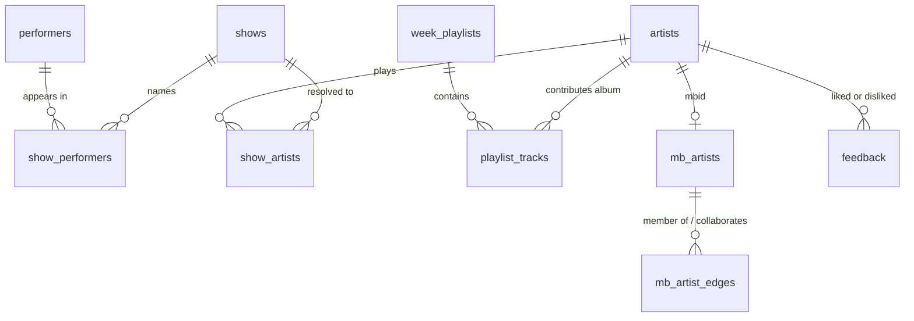

# Data Model

Schema is in [`migrations/0001_init.sql`](../migrations/0001_init.sql). This document covers
why it looks like this, and the queries that make the taste graph useful.

> **Not yet verified by execution.** The DDL has not been applied against a live Postgres
> (Docker was unavailable during authoring). A clean apply is an acceptance criterion on
> issue #1. Watch `COMMENT ON CONSTRAINT`, which is valid Postgres but unconfirmed here.

---

## 1. Three kinds of table

**Config** — `clubs`, `venue_group_members`. `clubs` rows with `source = 'scrape'` are
hand-edited; rows with `source = 'capitalbop_venue'` are mirrored from CapitalBop by the
pipeline, apart from a hand-set `city_override`. `venue_group_members` is written by the MCP
server ([ADR-021](DECISIONS.md#adr-021)) and by hand.

**Log** — `shows`, `performers`, `show_performers`, `artists`, `show_artists`,
`match_misses`, `week_playlists`, `playlist_tracks`, `playlist_events`, `rolling_playlists`,
`rolling_playlist_tracks`, `capitalbop_events`, `feedback`, `run_log`. Permanent.
**Nothing here is ever deleted**, including rows whose Spotify playlist has been unfollowed.
Spotify holds audio; this holds history.

**Cache** — `mb_artists`, `mb_lookup_misses`, `mb_artist_edges`, `capitalbop_extractions`.
Rebuildable from their sources, but treated as durable: MusicBrainz is rate-limited at
1 req/s, and re-extraction costs Haiku calls.

---

## 2. The four decisions the schema encodes

### `week_playlists (club_id, week_start_date)` is the idempotency key

`week_start_date` is the Tuesday of the booking week ([ADR-008](DECISIONS.md#adr-008)),
not an ISO week number, because clubs open new bookings on Tuesday and Village Vanguard
runs Tuesday–Sunday. A Monday-start week would split real residencies across two playlists.

Because the key is deterministic and reconciliation is a diff, re-running the pipeline
converges rather than duplicating. PRD 8.3's idempotency requirement is satisfied
structurally, not by defensive coding.

DC's rolling playlists use a second key, `rolling_playlists (region, slot_key)`, on the same
principle (section 7).

### Match quality is data, not a log line

`artists` carries `match_confidence`, `plausibility_score`, `verification_state`,
`needs_review`, and `match_notes`. This makes quality queryable:

```sql
-- Everything MusicBrainz never confirmed
SELECT name, verification_state, match_confidence, plausibility_score
FROM artists
WHERE verification_state IN ('unverified', 'unverifiable')
ORDER BY match_confidence;
```

`unverified` includes "MusicBrainz was down" and never implies the match is wrong
([ADR-006](DECISIONS.md#adr-006)).

### Misses are kept

`match_misses` retains acts that could not be resolved, with the raw name and the best
rejected guess. A logged miss is a signal worth investigating; silently skipping destroys
it.

### Feedback targets artists and tracks, never playlists

A weekly playlist holds several bands and many hours of music, so sentiment attached to it
says nothing ([ADR-014](DECISIONS.md#adr-014)). `show_id` and `week_playlist_id` are carried
as *context*, giving provenance: "liked Gerald Clayton, heard via Village Vanguard, week of
18 Aug".

---

## 3. The taste graph

Two edge sets from different sources with deliberately complementary coverage.



**Co-performance** — `show_performers` self-joined on `show_id`. Everyone who shared a
bandstand at your clubs, including sidemen with no discography at all.

**Recorded relationships** — `mb_artist_edges`, carrying `member of band`, `collaboration`,
and `parent`, with `instruments[]` and `begin_date`/`end_date`. A musician's whole recorded
history, well beyond the venues you watch.

Neither alone suffices. MusicBrainz is thin on young players; club listings know nothing
about records made before you started watching. Note that `mb_artist_edges.dst_mbid` is
deliberately **not** a foreign key — edges are discovered before the target artist has been
fetched, and requiring the target first would force a breadth-first crawl of MusicBrainz.

### What the graph answers well

```sql
-- 1. Every group a musician has been in, and when
SELECT e.dst_name, e.edge_type, e.instruments, e.begin_date, e.end_date
FROM mb_artist_edges e
JOIN mb_artists m ON m.mbid = e.src_mbid
WHERE m.name = 'Gerald Clayton'
ORDER BY e.begin_date NULLS LAST;

-- 2. Who has he actually shared a bandstand with, at your clubs
SELECT p2.name_display, sp2.instrument, count(*) AS nights
FROM show_performers sp1
JOIN performers p1  ON p1.performer_id = sp1.performer_id
JOIN show_performers sp2 ON sp2.show_id = sp1.show_id
                        AND sp2.performer_id <> sp1.performer_id
JOIN performers p2  ON p2.performer_id = sp2.performer_id
WHERE p1.name_norm = 'gerald clayton'
GROUP BY p2.name_display, sp2.instrument
ORDER BY nights DESC;

-- 3. The useful one: artists you have LIKED who have played with him
SELECT DISTINCT p2.name_display, f.sentiment, f.note_text
FROM show_performers sp1
JOIN performers p1 ON p1.performer_id = sp1.performer_id
JOIN show_performers sp2 ON sp2.show_id = sp1.show_id
                        AND sp2.performer_id <> sp1.performer_id
JOIN performers p2 ON p2.performer_id = sp2.performer_id
JOIN feedback f    ON f.target_type = 'artist'
                  AND f.target_id = p2.spotify_artist_id
WHERE p1.name_norm = 'gerald clayton'
  AND f.sentiment = 'liked';

-- 4. Which instruments do you actually respond to
SELECT sp.instrument, count(*) FILTER (WHERE f.sentiment = 'liked')    AS liked,
                              count(*) FILTER (WHERE f.sentiment = 'disliked') AS disliked
FROM feedback f
JOIN performers p        ON p.spotify_artist_id = f.target_id
JOIN show_performers sp  ON sp.performer_id = p.performer_id
WHERE f.target_type = 'artist' AND sp.instrument IS NOT NULL
GROUP BY sp.instrument
ORDER BY liked DESC;

-- 5. Which genres recur in what you like
SELECT g AS genre, count(*) AS liked_artists
FROM feedback f
JOIN artists a ON a.spotify_artist_id = f.target_id
CROSS JOIN unnest(a.genres) AS g
WHERE f.target_type = 'artist' AND f.sentiment = 'liked'
GROUP BY g
ORDER BY liked_artists DESC;

-- 6. Fuzzy recall: "who was that solo pianist last week"
SELECT s.show_date, c.name, s.act_name_raw, f.note_text
FROM shows s
JOIN clubs c ON c.club_id = s.club_id
LEFT JOIN feedback f ON f.show_id = s.show_id
WHERE to_tsvector('english', coalesce(s.raw_text, '')) @@ websearch_to_tsquery('piano solo')
   OR s.act_name_raw % 'pianist'          -- pg_trgm similarity
ORDER BY s.show_date DESC
LIMIT 10;
```

Queries 1–3 are what `artist_connections` exposes; 1, 4, and 5 combined are what
`artist_profile` returns in a single call.

### What the graph cannot answer, and why

There is no acoustic description of anything in this system. Spotify's `audio-features` and
`audio-analysis` were withdrawn for new applications in November 2024, and so were
`related-artists` and `recommendations`
([ADR-005](DECISIONS.md#adr-005)). Nothing here holds tempo, key, energy, or mood.

So a question like "what is his style like" is answered from:

1. **Genre tags** — `artists.genres` and `mb_artists.tags`. Coarse: `contemporary jazz`,
   `jazz fusion`.
2. **Your notes** — `feedback.note_text`. Precise, but only where you have written them.
3. **Lineage** — the graph. In jazz, "came up through Paul Motian's groups" is a genuine
   stylistic signal, and it is derivable from `mb_artist_edges` alone.
4. **The model's own knowledge** — rich, but *not grounded in your data*.

The graph's contribution to a style question is disambiguation and provenance: it pins down
which musician is meant and what they verifiably played on, so the model reasons about the
right person rather than a same-named one. It does not supply the description.

`artists.style_embedding vector(1536)` exists and stays NULL in v1, so embedding notes and
genres for similarity search is a later feature rather than a later migration.

---

## 4. Indexing

| Index | Serves |
|---|---|
| GIN `tsvector` on `feedback.note_text` | "what have I said about melancholy piano" |
| GIN `tsvector` on `shows.raw_text` | Free-text over listings |
| GIN `pg_trgm` on `feedback.note_text` | Typo-tolerant note search |
| GIN `pg_trgm` on `performers.name_norm`, `artists.name` | Half-remembered names |
| GIN on `artists.genres` | Genre affinity rollups |
| `shows (club_id, show_date DESC)` | "what played at the Vanguard on the 3rd" |
| `show_performers (performer_id)` | Co-performance traversal |
| `mb_artist_edges (dst_mbid)`, `(edge_type)` | Reverse and typed traversal |
| Partial on `artists (needs_review) WHERE needs_review` | Small, cheap review queue |

Both `tsvector` and `pg_trgm` are indexed on notes deliberately: stemming handles
`pianist`/`piano`, trigram handles misspellings. They fail differently, and recall matters
more than index size at this volume.

---

## 5. Volume and backups

Roughly 5 shows a day across 6 clubs: ~2,000 `shows` rows a year, ~10,000
`playlist_tracks`, a few hundred `feedback`. DC adds every CapitalBop event, ~65 a week:
~3,500 `shows` a year, and a few thousand `rolling_playlist_tracks` stints. The database will
not become large, so indexing generously costs nothing.

Nightly `pg_dump` to `/var/backups`, retained 30 days. **The log is the irreplaceable
asset.** Playlists can be rebuilt from club sites; a year of accumulated taste signal
cannot be reconstructed from anything.

---

## 6. Migration conventions

- Numbered, append-only: `0002_*.sql`, `0003_*.sql`. Never edit an applied migration.
- Every migration is wrapped in `BEGIN`/`COMMIT`.
- Applied with `psql -v ON_ERROR_STOP=1 -f`, so a partial apply fails loudly.
- Additive changes only where possible. This log is the asset; a destructive migration
  should be treated as a last resort and reviewed with that framing.

---

## 7. DC tables (migration `0003_dc.sql`)

Specified in [DC.md](DC.md). Non-destructive: new tables and columns, plus two relaxed
`NOT NULL` constraints guarded by CHECKs. No existing row changes and nothing NYC reads
changes meaning.

### Changes to existing tables

| Table | Change | Why |
|---|---|---|
| `clubs` | `source text NOT NULL DEFAULT 'scrape' CHECK (source IN ('scrape', 'capitalbop_feed', 'capitalbop_venue'))` | One table for every place a show can happen, so `shows.club_id` keeps a single foreign key (DC §3). The NYC scrape loop selects `source = 'scrape'`. |
| `clubs` | `schedule_url` becomes nullable, with `CHECK (source = 'capitalbop_venue' OR schedule_url IS NOT NULL)` | Venue rows have nothing to fetch |
| `clubs` | `capitalbop_term_id integer UNIQUE`, `capitalbop_slug text UNIQUE` | Mirroring key; `club_id = 'cb-' \|\| capitalbop_slug` |
| `clubs` | `city_override text` | Hand-set for venues with no address in the feed (DC §3) |
| `feedback` | `source` CHECK gains `'spotify'` | Removal-derived dislikes ([ADR-022](DECISIONS.md#adr-022)). `implicit` stays reserved for recently-played. |
| `feedback` | `rolling_playlist_id bigint REFERENCES rolling_playlists(id)` | Provenance, the DC counterpart of `week_playlist_id` |

`shows` is unchanged. A CapitalBop show writes its start time into `set_times` (`["19:00"]`),
keeping one shape for every tool that reads it.

### `capitalbop_events` — one row per CapitalBop instance

| Column | Notes |
|---|---|
| `instance_id integer PRIMARY KEY` | CapitalBop `id`: one date of one event |
| `event_id integer NOT NULL` | CapitalBop series id, shared across a residency; the extraction cache key |
| `show_id bigint NOT NULL REFERENCES shows` | If CapitalBop renames an act, this repoints to the new `shows` row; the old row is kept, stale |
| `start_time time`, `price_text text`, `ticket_link text` | As published |
| `cb_pick boolean`, `tags text[]`, `repeats boolean`, `neighborhoods text[]` | Eligibility inputs (DC §5) |
| `geocoded_city text` | `venue_detail.geolocation.city`; may be null |
| `description_html text`, `description_hash text` | Hash is the second half of the extraction cache key |
| `article_title text`, `article_url text`, `article_date date` | MCP context only (DC §2) |
| `first_seen_at`, `last_seen_at timestamptz` | `last_seen_at` older than the latest complete fetch = cancelled |

Index `(last_seen_at)`, and `(event_id)`.

### `capitalbop_extractions` — the Haiku cache

`PRIMARY KEY (event_id, description_hash)`, plus `result jsonb` (`leaders[]`, `performers[]`,
`album_mentioned`, `is_tribute`), `model text`, `created_at`. A residency's dates share one
row. Personnel from `result` is written to `performers` and `show_performers` for each
instance's show as usual.

### `venue_group_members` — what the MCP server may write

| Column | Notes |
|---|---|
| `id bigserial PRIMARY KEY` | |
| `club_id text NOT NULL REFERENCES clubs` | Must be a `capitalbop_venue` row; enforced by the repository and the MCP tool |
| `group_key text NOT NULL CHECK (group_key IN ('dc', 'blues-alley', 'alxjazz'))` | Mirrors `core/dc_groups.py`. Adding a group changes both, deliberately. |
| `filter_profile text NOT NULL CHECK (filter_profile IN ('all', 'standard', 'standard_no_pick', 'early_evening'))` | DC §4 |
| `added_via text NOT NULL CHECK (added_via IN ('seed', 'mcp', 'manual'))` | Provenance |
| `added_at`, `deactivated_at timestamptz` | Deactivation stamps, never deletes; re-adding opens a new row |

Partial unique index `(club_id, group_key) WHERE deactivated_at IS NULL`. "At most one
dedicated group per venue" (DC §4) spans rows, so the repository enforces it inside the same
transaction as the insert.

### `rolling_playlists` — invariant 4's key for DC

| Column | Notes |
|---|---|
| `id bigserial PRIMARY KEY` | |
| `region text NOT NULL`, `slot_key text NOT NULL` | `UNIQUE (region, slot_key)`: `('dc', 'next-2-weeks')`, `('dc', 'weeks-3-4')`, `('dc', 'weeks-5-6')`, `('dc', 'blues-alley')`, `('dc', 'alxjazz')` |
| `group_key text NOT NULL` | Which group feeds it |
| `spotify_playlist_id text`, `spotify_url text` | Null until the first reconcile creates it |
| `title text NOT NULL`, `description text`, `is_public boolean NOT NULL` | From `core/dc_groups.py` |
| `created_at`, `updated_at timestamptz` | |

There is no `spotify_removed_at`: these playlists are never unfollowed (DC §10).

### `rolling_playlist_tracks` — one row per stint

| Column | Notes |
|---|---|
| `id bigserial PRIMARY KEY` | A surrogate, unlike `playlist_tracks`, because one track can have several stints |
| `rolling_playlist_id bigint NOT NULL REFERENCES rolling_playlists` | |
| `spotify_track_id text NOT NULL`, `isrc text` | `isrc` powers the relinking guard (DC §11) |
| `spotify_album_id`, `spotify_artist_id`, `track_name`, `position` | As `playlist_tracks` |
| `show_id bigint REFERENCES shows` | Provenance; decides whether a removal is LaPortas feedback |
| `added_at timestamptz NOT NULL`, `removed_at timestamptz` | Open stint = `removed_at IS NULL` |
| `removal_reason text CHECK (removal_reason IN ('rolled_off', 'moved', 'ineligible', 'correction', 'user'))` | `CHECK ((removed_at IS NULL) = (removal_reason IS NULL))` |

Partial unique index `(rolling_playlist_id, spotify_track_id) WHERE removed_at IS NULL`: at
most one open stint per track per playlist. Index `(spotify_track_id, removal_reason)` serves
the reconciler's "ever removed by the user" exclusion, which spans all playlists.

Playlist mutations are also written to `playlist_events`, which gains a nullable
`rolling_playlist_id` and drops `NOT NULL` from `week_playlist_id`, with a CHECK that exactly
one is set.
