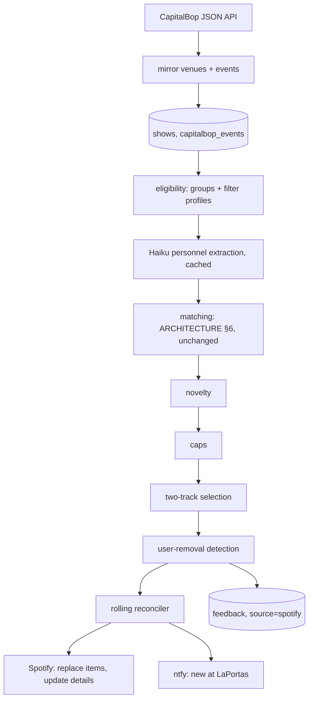

# DC Architecture

Technical specification for the Washington, D.C. extension. Issues reference sections of
this document as **DC §n**. It extends [ARCHITECTURE.md](ARCHITECTURE.md), which still
governs everything not restated here — in particular matching (§6), MusicBrainz
independence, and failure isolation (§10). Decisions are recorded in
[DECISIONS.md](DECISIONS.md), ADR-017 through ADR-024.

DC differs from NYC in shape, not in spirit. NYC has six hand-picked clubs, one request each,
and one weekly playlist per club. DC has one consolidated calendar
([CapitalBop](https://www.capitalbop.com/dcjazzcalendar/)) covering ~250 venues, so DC is
built from **filters over a feed** and produces three **rolling** playlists whose Spotify URLs
never change.

---

## 1. Shape

| Playlist | Built from | Shape | Visibility |
|---|---|---|---|
| `DC Jazz · Next 6 Weeks` | `dc` group (DC §4) | Single list | Public |
| `Blues Alley · Next 6 Weeks` | `blues-alley` group | Single list | Public |
| `AlxJazz · Next 6 Weeks` | `alxjazz` group | Single list | Private |

Each artist contributes **two tracks** (DC §8). The listening budget this was sized against
is 1–2 hours a week; at roughly 13 minutes per artist, the three playlists together carry
about 6 new artists a week, falling as novelty (DC §9) retires artists already rated.



Everything stored in `shows` — every CapitalBop event in the window, eligible or not — is
answerable over MCP (DC §13). Eligibility only decides what reaches a playlist.

---

## 2. Source: the CapitalBop JSON API

The calendar page is a Vue widget; the HTML carries no events. The widget reads a public
WordPress REST API, which this system reads directly. **No HTML fetch, no `trafilatura`, no
Playwright, and no LLM date parsing** for DC ([ADR-017](DECISIONS.md#adr-017)).

| Endpoint | Use |
|---|---|
| `GET /wp-json/capitalbop/v1/calendar` | Venue list (`venues[]`: `term_id`, `slug`, `name`) and neighborhood taxonomy. Once per run. |
| `GET /wp-json/capitalbop/v1/events?start_date=YYYY-MM-DD&end_date=YYYY-MM-DD&page=N` | Events, ~100 per page; response carries `max_pages`. A six-week window is ~4–5 pages. |
| `GET /wp-json/capitalbop/v1/event?instance=<id>` | The UI's "Read More". Its `event.description` is identical to the list endpoint's; the only extra field is `article`, a linked magazine post. Used **only** to capture that article (below). |

Fields consumed per event: `id` (the **instance**: one date), `event_id` (the **series**:
shared by every date of a residency), `name`, `start_date`, `start_time`, `venue.slug`,
`venue_detail.address`, `venue_detail.geolocation.city`, `neighborhoods[].slug`, `cb_pick`,
`tags[].slug`, `price`, `ticket_link`, `repeats`, `description` (HTML).

**Article context.** The `article` field is fetched only for playlist-eligible events whose
series has not been seen before (one request per new series, a handful a week), and stored
as `article_title`, `article_url`, `article_date`. It is MCP context, never extraction input
(DC §6): articles are often a decade old or about a different musician.

**Conduct.** `robots.txt` allows `/wp-json/`. One pass per daily run, pages fetched
sequentially with ≥1 s spacing, the same realistic `User-Agent` as the NYC fetcher. Personal
use, no redistribution.

**Cancellations.** An event that disappears from the feed is not deleted. Its
`capitalbop_events.last_seen_at` stops advancing; anything not seen in the current run's
complete fetch is treated as **cancelled**: excluded from eligibility, and excluded from
`when_is_playing` results. A run whose fetch did not complete (any page failed) skips the
cancellation sweep entirely, so a partial fetch can never cancel the rest of the calendar.

**Names.** Act names are cleaned before deduplication and matching: HTML entities decoded,
status markers stripped (`***SOLD OUT***`, `CANCELLED`, `POSTPONED`), then the existing
`core/normalize.py` suffix stripping. `Lalah Hathaway ***SOLD OUT***` and `Lalah Hathaway`
are one act.

---

## 3. Venues

CapitalBop venues become rows in `clubs` with `source = 'capitalbop_venue'` and
`club_id = 'cb-' || slug` (e.g. `cb-blues-alley`), so `shows.club_id` keeps one foreign key
and every MCP read tool works across NYC and DC unchanged. The feed itself is one more row,
`club_id = 'capitalbop'`, `source = 'capitalbop_feed'`, which is what `run_log` and chronic
failure key on (DC §14). The NYC scrape loop selects `source = 'scrape'` only.

Venue rows are **mirrored**, not hand-edited: each run upserts every venue in the
`/calendar` venue list. This is the one exception to "`clubs` is hand-edited" and it is
mechanical — the pipeline copies names and slugs, nothing more.

### City resolution

DC §5's geography filter needs a city per show. Resolved in order, first hit wins:

1. `clubs.city_override` — hand-set in `psql` for venues CapitalBop has no address for.
2. `venue_detail.geolocation.city` from the event.
3. Neighborhood slugs: `dc` → Washington, `alexandria` → Alexandria, `arlington` → Arlington.
4. Otherwise **unknown**: fails the geography filter, and is logged in `run_log.detail` with
   the venue name so a missing override is visible rather than silent.

Seeded overrides (CapitalBop carries no address for these):

| Venue slug | `city_override` |
|---|---|
| `hotel-heron` | Alexandria |
| `good-fortune-rooftop-bar-hotel-heron` | Alexandria |
| `old-waterfront-park` | Alexandria |
| `galaxy-hut` | Arlington |

---

## 4. Groups and filter profiles

Three **groups**, hardcoded in `core/dc_groups.py` with their playlist definitions: titles,
caps, visibility ([ADR-018](DECISIONS.md#adr-018)). Adding a fourth group is
a code change and a deploy — deliberately, because a group means a new Spotify playlist and
the MCP server must never cause one to exist.

| Group | Membership | Shape | Cap |
|---|---|---|---|
| `dc` | Every **CB Pick** passing the `standard` profile and the geography filter, plus shows at venues that are members of `dc` (each under its own profile) | Single list | 12 artists |
| `blues-alley` | Shows at member venues | Single list | None |
| `alxjazz` | Shows at member venues | Single list | None |

**Membership** is data, in `venue_group_members` (DATA_MODEL §7), and is what the MCP server
may write (DC §13, [ADR-021](DECISIONS.md#adr-021)). A venue belongs to **at most one**
dedicated group (`blues-alley`, `alxjazz`); a venue in a dedicated group is excluded from the
`dc` CB Pick rule, so no show lands in two playlists.

Each membership carries a **filter profile**:

| Profile | Rules (DC §5) |
|---|---|
| `all` | No filters |
| `standard` | CB Pick required, ticketed, evening, not a resident |
| `standard_no_pick` | `standard` without the CB Pick requirement |
| `early_evening` | Starts 18:00 or later, any day. No ticket rule, no resident cap |

**Jam sessions are excluded under every profile**, including `all`. The geography filter
applies only to the `dc` CB Pick rule; member venues are, by being added, already known to be
somewhere wanted.

Seeded memberships:

| Group | Venue slug | Profile | Why |
|---|---|---|---|
| `blues-alley` | `blues-alley` | `all` | Touring acts with real catalogs; every booking is wanted |
| `alxjazz` | `laportas` | `early_evening` | Lists no prices (so "ticketed" rejects everything) and is a fixed resident roster; novelty does the quality filtering |
| `alxjazz` | `the-birchmere` | `standard_no_pick` | Mostly non-jazz bookings; filters keep the jazz nights |
| `alxjazz` | `hotel-heron` | `all` | Rare, wanted, daytime included |
| `alxjazz` | `good-fortune-rooftop-bar-hotel-heron` | `all` | Same venue, second CapitalBop term |
| `alxjazz` | `old-waterfront-park` | `all` | Hosts Alexandria Jazz Fest each June |

---

## 5. Eligibility

All eligibility is computed from feed fields **before** extraction and matching, in
`core/eligibility.py` (pure: inputs are event records and the window, no I/O). Only eligible
events are extracted, which is what keeps Haiku cost at cents a week.

| Rule | Definition |
|---|---|
| **Window** | `start_date` from today (America/New_York) through the Sunday ending week 6, where week 1 is the **Monday-start** week containing today ([ADR-018](DECISIONS.md#adr-018)). Shows earlier today are still in. |
| **Not cancelled** | Seen in the current complete fetch (DC §2) |
| **Not a jam** | No `jam-session` tag, and `jam` does not appear as a word in the cleaned act name |
| **CB Pick** | `cb_pick = true` |
| **Ticketed** | Not tagged `free` or `no-cover`, and `price` text is not "Free" or "No Cover". A blank price **passes**: blank means unknown, not free. |
| **Evening** | Mon–Fri: starts 19:00 or later. Sat–Sun: starts 17:00 or later. Friday is a weekday. |
| **Not a resident** | The cleaned act name has **≤ 3** distinct show dates in the window, counted across every venue |
| **Geography** | Resolved city (DC §3) ∈ {Washington, Alexandria, Arlington} |

Measured against the live feed on 2026-10-11 (window Oct 11 – Nov 15): `dc` 10 artists
(5 / 5 / 0 across the three slots the `dc` list had at the time, now one six-week list), `blues-alley` 16, `alxjazz` 13. The feed gains shows daily, so these
counts drift; `tests/fixtures/capitalbop/eligibility_snapshot.json` pins this snapshot. These
are pre-match ceilings — acts that fail matching drop out.

---

## 6. Extraction

Feed fields already give date, time, venue, and price, so Haiku's only job is **personnel**:
who leads, and who else is named. One call per eligible event series, input is the cleaned
act name plus the `description` text with HTML stripped — **never** the article
([ADR-017](DECISIONS.md#adr-017)).

Strict JSON schema output:

| Field | Notes |
|---|---|
| `leaders[]` | One or more names. A festival day ("Alexandria Jazz Fest – Day 2") or a double bill ("Raphael Rogiński / Sarah Hughes") yields several. Each becomes its own `show_artists` candidate. |
| `performers[]` | `{name, instrument}` for every musician the description names. Not optional ([ARCHITECTURE §5](ARCHITECTURE.md#5-extraction)). |
| `album_mentioned` | If the description names one |
| `is_tribute` | True for repertory acts ("Radiohead Jazz Project", "music of…"). **Stored, not acted on** in this version; the leader is the performing act, never the honoured artist. |

**Cache.** Keyed on `(event_id, sha256(description))` in `capitalbop_extractions`. A
residency is extracted once; it is re-extracted only when CapitalBop edits the description.
Expected cost: ~12–15 new series a week at ~$0.0015 each (Haiku 4.5 at $1 / $5 per MTok,
~800 prompt tokens, ~150 output tokens).

The adapter is `adapters/anthropic_extractor.py` behind a new port method,
`Extractor.extract_personnel(act_name, description) -> PersonnelExtraction`.

---

## 7. Matching

**Unchanged.** Every leader runs ARCHITECTURE §6 stages 1–7 exactly as an NYC act does, with
the same thresholds and the same MusicBrainz independence. Invariant 8 (a wrong match is
worse than no match) applies with undiminished force: two wrong tracks are less costly than a
wrong album, but they are still a stranger in a playlist you share.

Known hazard for the fixture set: **Chuchito Valdés** and **Chucho Valdés** (son and father,
both Cuban pianists, both with real catalogs) were booked in the same window. A same-surname
generational pair belongs in the plausibility and adjudication fixtures.

---

## 8. Track selection: two per artist

DC playlists carry **two tracks per artist**, not an album
([ADR-020](DECISIONS.md#adr-020), departing from [ADR-010](DECISIONS.md#adr-010)). Spotify's
February 2026 migration **removed** `GET /artists/{id}/top-tracks` and the `popularity` field
on tracks, albums, and artists, and the March 2026 partial reversion did not restore either.
There is no way to ask Spotify for "top songs".

`core/selection.py` gains `select_tracks(matched_artist_id, search_results, fallback_album_tracks)`:

1. **Primary — search as popularity proxy.** One `GET /search?type=track&q=artist:"<name>"`
   call. Search ranking is relevance-ordered and tracks popularity closely.
2. Keep tracks whose **first** listed artist is the matched `spotify_artist_id` — sideman
   appearances on other leaders' records are excluded, the same reason ADR-010 filters
   `appears_on`.
3. Drop duplicate titles after normalizing (case, "- Live", "(Remastered …)", "Alternate
   Take"), keeping the first occurrence.
4. Take the first two, preferring two different albums.
5. **Fallback** — fewer than two survive: fill from the first tracks, by `track_number`, of
   the album ARCHITECTURE §7 would select.

Order within an artist: the two tracks in search-rank order.

---

## 9. Novelty

Applies to all three playlists ([ADR-019](DECISIONS.md#adr-019)). Computed in
`core/novelty.py` from the artist's **most recent** artist-level `feedback` row:

| Latest artist-level feedback | Effect |
|---|---|
| `disliked` | Excluded from every DC playlist, permanently |
| `liked` | Excluded for 6 months from that feedback's `created_at` (`NOVELTY_LIKED_DAYS = 182`) |
| `neutral`, a note only, or none | No effect |

"Most recent" makes it reversible: a later `liked` over MCP lifts a `disliked`. Track-level
dislikes (DC §11) never exclude an artist by themselves; they exclude that track.

An excluded artist is still stored, still matched, and still answerable through
`when_is_playing` — novelty governs playlists, not knowledge.

---

## 10. Caps and the rolling reconciler

### Window

Week 1 is the Monday-start week containing today. All three playlists are single lists over
weeks 1–6, and an act appears once, ordered by its earliest eligible show. As shows pass, acts
roll off. (The `dc` group was three two-week slots until [ADR-025](DECISIONS.md#adr-025):
the far slots were nearly empty, and the whole window is only about a dozen artists.)

### Caps

The `dc` playlist caps at **12 artists**, ranked: CB Pick first, then earliest show date, then act
name for determinism. Overflow is not dropped from the system — it is in `shows`, answerable
over MCP, and enters the playlist as earlier artists roll off. Venue lists are uncapped.

### The key

Rolling playlists live in `rolling_playlists`, keyed `UNIQUE (region, slot_key)` — e.g.
`('dc', 'next-6-weeks')`, `('dc', 'blues-alley')`. This is invariant 4's key for DC; NYC keeps
`(club_id, week_start_date)` untouched. Rows are upserted from `core/dc_groups.py` at the
start of each DC run, so a playlist row exists before any Spotify call.

Track history is `rolling_playlist_tracks`, one row per **stint**: a track added, later closed
with `removed_at` and a `removal_reason`. A track that leaves and later returns (an artist
re-booked months on) gets a new row. Rows are never deleted (invariant 5).

| `removal_reason` | Meaning |
|---|---|
| `rolled_off` | The show passed or left the window |
| `moved` | The artist moved to another playlist (a venue joined or left a dedicated group) |
| `ineligible` | Cancelled, a filter or membership change, novelty, or cap overflow |
| `correction` | ARCHITECTURE §6 stage 7 changed the match |
| `user` | Removed by Brian in Spotify (DC §11) |

### Reconciliation, per playlist

1. **Detect user removals** (DC §11). Must precede everything else.
2. Compute the desired ordered track list: eligible, matched, non-excluded artists, ordered by
   earliest show date then by act name, two tracks each, **minus every track whose latest
   stint closed with `user`**.
3. Compare with the live stint rows (`removed_at IS NULL`).
4. If membership or order differs: **write the database first** — close departing stints with
   their reason, open new stints — **then** `PUT /playlists/{id}/items` with the full ordered
   list. Lists are far below Spotify's 100-item replace limit (cap 12 × 2 = 24 on dc; Blues
   Alley ~40). If the Spotify call fails, the run records `partial`, and the next run's
   identical desired list converges.
5. If title or description differs: `PUT /playlists/{id}` (playlist-details editing, which the
   February 2026 migration did not change).

Write-database-first matters for DC §11: a crash between the two writes must never leave a
track missing from Spotify that the database still believes is live, because that is
precisely the signature of a user removal.

**Idempotency** is by construction, as in NYC: the key is deterministic, the desired list is a
pure function of stored state, and an unchanged list issues no Spotify write. The
idempotency test (AGENTS.md) gains a rolling case.

**Playlists are created** on first sight of a `rolling_playlists` row with no
`spotify_playlist_id`, via `POST /me/playlists` with `public` from `core/dc_groups.py`.
**They are never unfollowed** — retention (ARCHITECTURE §9) operates on `week_playlists` only,
so DC is exempt by construction, and a followed URL never breaks.

**Descriptions** list artists with day and venue in show order, e.g.
`Maria Grand (Sun 10/18, Rhizome) · Aaron Myers (Fri 10/23, Mr. Henry's)`, truncated at
Spotify's 300-character limit.

---

## 11. User removals as feedback

Brian owns these playlists and can delete a track from one in the Spotify app. Every such
removal in **AlxJazz** is respected; only removals of tracks from **LaPortas** shows are
recorded as dislikes ([ADR-022](DECISIONS.md#adr-022)). Other DC playlists are untouched by
this section in this version.

### Detection, in `core/removals.py` (pure) fed by the reconciler

1. Read the live playlist: `GET /playlists/{id}/items`, every page.
2. **Complete read or nothing.** If any page fails, skip detection for this playlist this run.
3. Missing = live stints (`removed_at IS NULL`) whose track is absent from the read.
4. **Relinking guard.** Spotify can serve an equivalent recording under a different track ID;
   the `linked_from` field that used to explain this was removed in February 2026. Before
   declaring a track missing, compare by ISRC (`external_ids.isrc`, restored March 2026)
   against the read. An ISRC match is the same track, not a removal.
5. **Anomaly guard.** If more than half of the live stints are missing at once, record nothing,
   leave the stints open, and send one `ntfy` alert. A mass disappearance is a Spotify or
   account problem, not a change of taste.

### Effect

Each confirmed missing track: close the stint with `removal_reason = 'user'`. Then, only if
the stint's `show_id` is at `cb-laportas`:

| Removed | Writes |
|---|---|
| One of the artist's tracks | `feedback(target_type='track', target_id=<track>, sentiment='disliked', source='spotify')` |
| The artist's last remaining track (both removed) | The track row above **plus** `feedback(target_type='artist', sentiment='disliked', source='spotify')`, which novelty (DC §9) makes permanent |

Both carry `show_id` as provenance. The reconciler's step-2 exclusion means a removed track
is never re-added, in any playlist, including when the artist is booked again. Detection is
naturally idempotent: a closed stint is no longer live, so the next run cannot see it go
missing twice.

No replacement track is chosen for a removed one; an artist with one track removed stays with
one.

---

## 12. New-artist notification

When a reconcile **adds** an artist to AlxJazz from a LaPortas show who has never had a stint
in AlxJazz before, send one `ntfy` push per run listing every such artist
([ADR-023](DECISIONS.md#adr-023)):

```
AlxJazz · new at LaPortas
Esther Haynes — Wed 10/21, 6:30pm
```

- **Batched**: one push per run, never one per artist.
- **First run silent**: if AlxJazz had no stints before this run, it is seeding, and sends
  nothing.
- **Post-novelty**: "added" means it passed novelty, so a rated resident never pushes.
- Same topic as the chronic-failure alert, distinguished by title and an `ntfy` tag, so
  failures still stand out. A push failure is logged and never fails the run.

---

## 13. MCP changes

### Reads

| Tool | Purpose |
|---|---|
| `when_is_playing(name, region?)` — **new** | Upcoming, non-cancelled shows for an act or performer, soonest first. Fuzzy over act names and performer names (`pg_trgm`), so "Sharon Clark" finds "Sharón Clark Trio". Each row: date, start time (ET), venue, address, price, ticket link, CapitalBop article (if any), and which playlist the act is in, if any. Answers for **every** stored show, eligible or not. |
| `list_venue_groups()` — **new** | The three groups, their active member venues with profiles, and each playlist URL |
| `whats_playing_at(club, date)` | Works for DC unchanged; DC venues are `clubs` rows (`cb-blues-alley`) |
| `search_shows`, `artist_profile`, `artist_connections`, `search_notes` | Unchanged; DC shows and performers flow into them automatically |

### Writes ([ADR-021](DECISIONS.md#adr-021))

| Tool | Purpose |
|---|---|
| `add_venue_to_group(venue, group, profile = 'standard')` — **new** | `venue` is resolved against `clubs` rows with `source = 'capitalbop_venue'` by fuzzy name. **Exactly one** match writes; zero or several returns the candidates and writes nothing, the same resolve-then-write discipline as feedback. `group` must be one of the three; `profile` one of DC §4's four. Adding a venue already in another dedicated group is rejected with a message naming that group. |
| `deactivate_venue(venue, group)` — **new** | Stamps `deactivated_at`. The row is kept; re-adding opens a new row. |
| `record_feedback(...)` | Unchanged |

Venue writes take effect on the next daily run. Nothing in this set creates a group, creates a
playlist, touches tracks or matches, or triggers a run.

---

## 14. Orchestration and failure

`pipeline.daily` runs DC after the NYC clubs, inside its own `try`/`except`, writing a
`run_log` row against `club_id = 'capitalbop'`. DC is one unit for failure purposes: the feed
is one source, and a failed fetch means no DC playlist can be trusted that day, so none is
touched. Outcomes reuse the existing set (`success`, `fetch_fail`, `extract_fail`, `partial`,
…). Three consecutive DC failures fire the existing chronic-failure push (ARCHITECTURE §10).

Within a successful fetch, each of the three playlists reconciles inside its own
`try`/`except`, so one playlist's Spotify failure never blocks the others.

---

## 15. Module layout additions

```
core/
  dc_groups.py      # the three groups, three playlists, caps, visibility, profile names
  eligibility.py    # DC §5 predicates; pure
  novelty.py        # DC §9; pure
  removals.py       # DC §11 detection and guards; pure
  weeks.py          # + Monday-start window arithmetic beside the existing Tuesday logic
  normalize.py      # + status-marker stripping (DC §2)
  selection.py      # + select_tracks (DC §8)
ports/
  calendar.py       # CalendarSource: venues(), events(window) -> complete-or-raise
  extractor.py      # + extract_personnel
  music.py          # + search_tracks, get_playlist_items, replace_playlist_items,
                    #   update_playlist_details; create_playlist gains `public`
adapters/
  capitalbop.py     # the JSON API client (DC §2)
  pg/               # + rolling playlist, venue group, CapitalBop event repos
pipeline/
  dc.py             # DC run: mirror, eligibility, extract, match, reconcile, notify
  reconcile_rolling.py
mcp/
  tools_venues.py   # add_venue_to_group, deactivate_venue, list_venue_groups
```

The dependency rule is unchanged: `core/` stays pure, and `CalendarSource.events` raises
rather than returning a partial window, so "complete fetch" (DC §2) is enforced at the port.

---

## 16. Deliberately deferred

Designed or discussed, and **not** in this version:

- **Spotify likes as thumbs-up.** Saved tracks are readable through the library endpoints
  (consolidated, not removed, in February 2026). A natural pair to DC §11.
- **Removal feedback beyond LaPortas**, and for NYC weekly playlists.
- **Tribute and genre gating.** `is_tribute` is captured (DC §6); the user chose to rely on
  feedback. If needed: exclude `is_tribute` from playlists, and drop artists whose Spotify
  `genres` are non-empty with nothing jazz-adjacent (empty genres pass; artist `genres`
  survived February 2026).
- **Personnel for every event**, not only eligible ones: ~$0.10–0.20 a week more, richer
  co-performance graph across the whole DC scene.
- **Creating groups over MCP.** Rejected for now (ADR-021); a group is a playlist.
